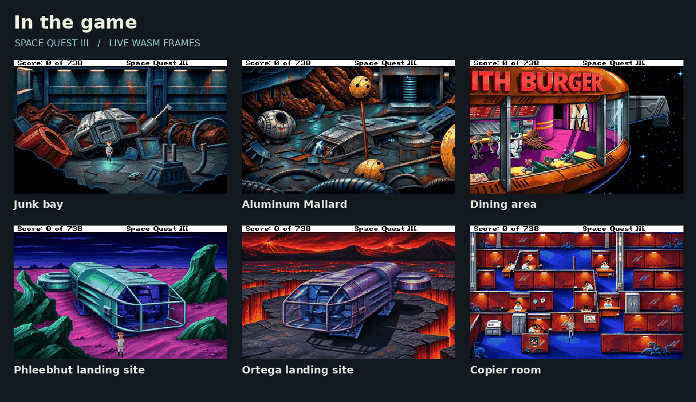

# Space Quest III in the browser

Play *Space Quest III: The Pirates of Pestulon* with a chat-style command interface and switchable EGA and VGA-style graphics. A patched ScummVM SCI interpreter runs in WebAssembly. Sierra’s original scripts still decide what Roger can say, pick up, walk behind, and get killed by.



**Bring your own English DOS game ZIP.** The app reads it in browser memory. The repository supplies the player, enhanced artwork, and a gallery of 101 shareable PNG plates. For the story behind the art, including a worked example of getting the escape-pod door to line up, read [How the graphics were enhanced](docs/graphics.md).

## Run locally

From the repository root, run these commands with Python 3. The checked-in WebAssembly runtime and art packs are ready to use.

```sh
python3 tools/build_pages.py
python3 -m http.server 8073 --bind 127.0.0.1 --directory _site
```

1. Open [the local game](http://127.0.0.1:8073/). Choose a ZIP from your device, or paste a direct ZIP URL and select **Load ZIP**.
2. Click the title sequence to skip it, or let it play. Once Roger leaves the pod, try `look pod` in **Transmissions**.
3. Click the scene to walk. Press the **backtick** key to compare both graphics treatments with Roger standing in the same spot.

The supported release has `RESOURCE.MAP`, `RESOURCE.001`, `RESOURCE.002`, `RESOURCE.003`, `VERSION`, `ADL.DRV`, and `SNDBLAST.DRV` in one directory inside the ZIP. That directory may be nested, and filenames may be lowercase. The importer accepts ZIPs up to 32 MiB and verifies the map and three volumes against the hashes in [the game configuration](config/game.json).

Local ZIPs stay on the device. A remote URL must return the ZIP and allow cross-origin browser requests. Internet Archive download links use its own cross-origin endpoint. If a host blocks the request, download the ZIP and use the file picker. Reloading the page prompts for the game again. Saves persist in IndexedDB for the same browser profile and site address.

## Controls

| Action | How |
| --- | --- |
| Walk | Click a destination, or focus the game screen and press an arrow key. Press the same arrow again to stop. |
| Give Roger a command | Type in **Transmissions** and press **Enter**. Ordinary text responses appear in the conversation. Make timed choices and use instruments on the game screen. |
| Get a room hint | Type `hint`. Repeat for the next clue. Changing rooms resets the sequence. |
| Compare graphics | Press **backtick** with the game screen focused, or click the graphics button below it. The choice carries into the next room. |
| Explore locations | With the screen focused, press `[` to go back or `]` to go forward through 54 walking locations in SCI room-number order. The ends wrap. These jumps change the live game, so save first to return to your adventure. |
| Save or restore | Focus the game and press **F5** to save or **F7** to restore. |
| Inspect or share artwork | Open **Controls** for the room inspector, scene capture, PNG gallery, and downloadable gallery ZIP. |

## Publish on GitHub Pages

1. Put the **extracted repository contents** in your GitHub repository. Keep `index.html`, `README.md`, and the hidden `.github/` directory at its root.
2. In **Settings → Pages → Build and deployment**, choose **GitHub Actions** as the source.
3. Push to `main` or manually run **Publish game to Pages** in the **Actions** tab. Open the deployment URL from the completed run.

The workflow runs the same Python build shown above and publishes `_site/`. Relative paths support a project site under `/<repository>/`. Gameplay, ZIP import, hints, graphics, and saves all run in the browser. Another static HTTPS host can serve the contents of the same directory with `.wasm` served as `application/wasm`. [Pages workflow](.github/workflows/pages.yml) · [Public file list and build](tools/build_pages.py)

## Project layout

| Path | What it contains |
| --- | --- |
| [web/](web/) | Player UI, ZIP import, SCI bridge, artwork loader, and scene inspector. The prebuilt interpreter and its notices are in `web/runtime/`. |
| [config/game.json](config/game.json) | Game-file fingerprints, music driver, room names, walking entrances, hints, and visual templates. |
| [config/pictures.json](config/pictures.json) | The 115 SCI picture IDs, their uses, art-pack paths, and associated views. Room and picture IDs can differ. |
| [art/](art/) | Painting masters, compiled backgrounds, shaded sprite sheets, palette manifests, and frame metadata. |
| [gallery/](gallery/) | Numbered PNG plates, chapter contact sheets, and an HTML index. The site build assembles these into a downloadable ZIP. |
| [engine/](engine/) | Interpreter patches, browser filesystem setup, and WebAssembly build script. |
| [tools/](tools/) | Static-site builder, art compilers, and gallery builder. |

### Edit hints and entrances

Room entries are keyed by SCI room number. Edit `hints` to change a room’s clue sequence. A `variants` entry can supply different clues when its `when` conditions match. In the junk bay, `motivatorHere` comes from the live game variable that tracks the warp motivator. Unknown rooms use `defaultHints`, and repeating `hint` eventually repeats the final clue.

A `walkEntry` adds a room to bracket navigation. Its `from` value selects an entrance for the room script, and `x` and `y` give Roger’s starting foot position. Some rooms use `placeAfterInit` to reapply those coordinates after setup. The freighter rail rooms use `onRail` to bring Roger in on foot. Rebuild the static site and reload after editing the configuration.

### Rebuild the interpreter

On Linux, with Bash, Python 3, curl, tar, patch, GNU Make, and a C/C++ build environment, run `./engine/build.sh`. It downloads ScummVM 2.9.0 and Emscripten 3.1.51, applies the project’s patches, builds SCI, and installs the loader, WASM binary, and license notices into `web/runtime/`. Allow several GB for the build. `BUILD_DIR` changes the build directory and `JOBS` changes the default of four compile jobs. Run the Pages build again to stage the updated runtime. [Build script](engine/build.sh)

## Credits and distribution

*Space Quest III* is Sierra’s game. This fan project distributes enhanced artwork derived from its imagery. Players supply the original game files. The original DOS distribution, unmodified extracted image layers, and local sprite-source atlas are excluded from the repository package.

ScummVM powers the interpreter. Its license, copyright notice, and third-party notices accompany the runtime. The ZIP importer uses fflate under the MIT license. Room-script research used the sluicebox SCI script reference. [ScummVM 2.9.0 source](https://github.com/scummvm/scummvm/tree/v2.9.0) · [Runtime license](web/runtime/COPYING) · [Runtime credits](web/runtime/COPYRIGHT) · [Third-party notices](web/runtime/LICENSES/) · [fflate license](web/vendor/fflate/LICENSE) · [SQ3 script reference](https://github.com/sluicebox/sci-scripts/tree/main/sq3-dos-1.018/src)
