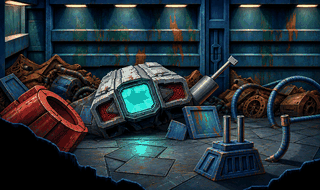
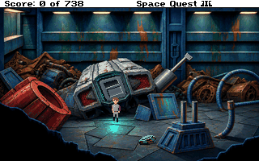

# How the graphics were enhanced

The junk bay began with a practical problem. Its escape pod belongs to the painted scenery, but the hatch is a separate animated object. A convincing painting with the hatch three pixels too far right looks fine until the door opens. The solution was to ask Sierra’s interpreter for the empty room, its depth and control maps, and the exact animation frames. That gave the artwork a coordinate system and gave us a way to test the result in motion.

| Junk bay background compiled for play | A frame rendered by the game |
| --- | --- |
|  |  |

The left image is 320 × 190. The right image is a 320 × 200 screen capture that includes the ten rows above the playfield. When comparing coordinates, a point at picture `y = 84` in this room is at screen `y = 94`. The larger [painting master](../art/junk-bay/painting.png) shows the detail available for the gallery.

## 1. Inventory the material by picture ID

SCI uses several kinds of resources. A **room script** controls what happens at a location. A **picture** supplies scenery or a graphic the script can draw. A **view** contains animation sequences called *loops*, each made of frames called *cels*. One room can draw different pictures as a puzzle changes state, and several rooms can reuse a picture or a view.

The development pass enumerated picture resources from the DOS resource map and used room and region scripts to associate pictures with likely views. Live captures then supplied actual actor names, frame IDs, positions, and drawing priorities. The catalog uses the **picture ID** to choose artwork. For example, room 15 can draw picture 157 when the debris hollow loses power. A replacement indexed only by room 15 would show the lights on after the reactor was removed. [Picture catalog](../config/pictures.json)

| Catalog treatment | Pictures | How the game presents them |
| --- | ---: | --- |
| Painted scenery | 78 | Compile a high-resolution, reference-guided painting to the SCI picture grid. |
| Technical graphics | 17 | Recolor the source inks and apply a narrow glow to preserve lettering, instrument layouts, and stars. |
| Incremental overlays | 13 | Let SCI apply the vector commands to the picture already on screen. An opaque replacement here would erase the underlying scene. |
| Animation backdrops | 4 | Keep the background simple and let scripted actors supply the visible subject. Three packs specify a blank background. |
| State variants | 3 | Derive each alternate state from its corresponding painted scene, described below. |

These counts cover all 115 picture resources. The 54 bracket-navigation stops are a separate list of places where the player can visit Roger.

## 2. Capture the empty picture and the live cast

The patched ScummVM renderer runs the original SCI picture commands, including fills and lines. A hook reads the picture rectangle as soon as that draw finishes, before actors and static cels are added. For each pixel it exports three indices.

| Plane | What it tells the artist |
| --- | --- |
| Visual | The original 16-color EGA composition, including the locations of doorways, floor edges, and equipment. This is the reference for the paint-over. |
| Priority | The depth value SCI tests when drawing a cel. A sufficiently high foreground priority hides Roger where he passes behind scenery. |
| Control | Region values that game scripts interpret for boundaries, triggers, or special movement. Their meaning depends on the room. |

The private source PNGs translate visual indices through the EGA palette. For the other two planes, index `n` becomes grayscale `17 × n`, so all sixteen values remain distinguishable. Packing the same three indices per pixel into a capture also makes it possible to compare numeric maps across renders.

The view export records `(view, loop, cel)`, width, height, displacement `(dx, dy)`, transparency key, and decoded pixels. The interpreter resolves mirrored loops during decoding. A **separate live capture** samples the animation list while the frame is composited. It supplies each actor’s name, current view/loop/cel, priority, and screen bounds. Right and bottom bounds are exclusive. In one junk-bay frame the `door` is view 12, loop 1, cel 0, priority 9, with bounds `[120, 93, 157, 126]`. This is where the 37 × 33 scripted door actually draws. [Capture hooks](../engine/art.patch) · [Junk bay cast sample](../art/junk-bay/source/cast.json)

A live sample describes one game state. The per-picture view list can contain other frames and actors that arrive later. Conversely, an object baked into a picture may have no actor record at all.

## 3. Make a reference-guided painting

The large `painting.png` files are AI-assisted paint-overs created with OpenAI image generation. The original empty room supplied the composition. The art direction aimed for the richer color, material detail, and lighting of the later VGA-era *Space Quest* games. The art tree contains 79 generated masters because the 78 painted pictures and the collapsed-ledge variant each have their own painting. The masters are roughly 1,628 × 966 pixels. The Python compilers start with these finished images, so recompiling a pack requires no image-generation service.

For a new room, start with the empty visual plane. Mark the entrances, walkable floor, props that Roger handles, and places where animated cels must meet the background. Use the priority and control views to interpret those constraints. Keep actors that the script draws on their own layers out of the background painting. Test lighting and silhouettes at 320 × 190 early enough to catch details such as a pipe that disappears into the floor at gameplay size.

A brief for another junk-bay pass could read as follows.

> Use the supplied empty junk bay as the framing reference. Keep the pod, hatch opening, floor line, and exits in their original positions. Give the scrap metal distinct painted surfaces and the pod a readable silhouette at low resolution. Leave Roger, the animated door, and the loose engine part to the game.

This is a reusable art-direction example. The committed masters are the inputs for reproducing the shipped packs.

### Register the junk-bay hatch

The opening-room compiler resizes the painting with Lanczos resampling, then locates the cyan hatch in a fixed search region on the pod. It measures the cyan bounds in both images and warps the painted hatch onto the original. The warp uses an eight-pixel mesh, bicubic interpolation, and a falloff around the door so distant fixtures and the floor retain their positions.

On the included master, the cyan bounds after resizing are `[125, 87, 158, 115]`. The original bounds are `[122, 84, 156, 114]`. After registration, the painted bounds match the original. These are inclusive extrema of the cyan pixels in **picture** coordinates. They measure a feature inside the hatch, while the cast sample measures the entire door cel in **screen** coordinates. [Hatch registration and opening-room compiler](../tools/junk_bay_art.py)

### Where computer vision enters the process

The hatch uses a local color test. For selected landmarks, the inspector scans the visual plane for an authored EGA pixel template. The junk bay’s “Escape pod upper hull” template is 32 × 12 pixels with a minimum agreement of 96%. Its result carries a bounding box and a pixel-agreement score. To add another landmark, supply equal-width rows of EGA indices and a threshold in the room configuration. Actor identification uses the interpreter’s cast list directly. Automatic recognition of arbitrary scenery would require additional work. [Template configuration](../config/game.json) · [Matching algorithm](../web/scene.js)

## 4. Shade the animation cels

Recoloring whole screenshots would leave Roger attached to a single pose. Instead, the compiler processes every animation cel independently, preserving its dimensions, transparent pixels, and displacement from the actor’s anchor point.

1. Map the original EGA ink index to a material swatch. Views 0, 6, and 11 use the cloth-oriented swatches. Other views use the metal-oriented set.
2. Compute luminance and blur it slightly. A diagonal difference across this softened image supplies bounded edge shading. A gentle top-to-bottom and left-to-right light gradient adds form inside the silhouette.
3. Restore the original alpha channel and pack the shaded cel at its recorded atlas coordinates. Shading individual cels keeps neighboring sprites on the sheet from bleeding into one another.
4. Give the sprites their own palette budget. A small character can otherwise lose important skin and clothing colors when a room full of scrap metal dominates the color histogram.

The six opening packs (IDs 2–7) have individual atlases and palettes. The later packs share an atlas of **3,769 cels across 186 views**, packed into 2,048 × 1,685 pixels. Their room sheets are useful for inspection, while their runtime manifests point at the shared atlas and frame index. An atlas `x, y` locates pixels **in the file**. The cast bounds and SCI displacement tell the renderer where to put those pixels **on screen**. [Shared frame index](../art/shared/cels.json) · [Shared atlas compiler](../tools/build_picture_art.py)

## 5. Compile the color packs and handle exceptions

Each manifest supplies picture dimensions, origin, image paths, and 239 RGB palette entries. The first 16 hardware palette slots remain available for EGA. Slots 16–206 hold 191 background colors, slots 207–254 hold 48 sprite colors, and slot 255 remains available to SCI. The opening compiler derives the two budgets from that room’s painting and opaque sprite samples, then maps both outputs to the combined table. The shared compiler quantizes each room’s background separately and appends the common sprite palette.

Three variants illustrate why the treatment depends on what the story changes.

- **Sleep chamber, picture 156.** Reuse painting 155, amplify red, and reduce green and blue for the warning-light state.
- **Debris hollow, picture 157.** Darken painting 15 with different factors for each color channel when the reactor loses power.
- **Lava crevice, picture 65.** Compare the two original picture grids to find the changed ledge. Expand the mask with a nine-pixel maximum filter and soften it with a Gaussian blur. Composite the alternate painting through that mask so unchanged rock faces line up with picture 66.

For technical graphics, the compiler maps each EGA ink to a display color and adds a small blurred halo. This preserves glyph strokes and individual stars. For inset scenes 90, 420, and 690 it derives an interior mask from the original black surround and restores those areas to black. [Picture treatments and palette construction](../tools/build_picture_art.py)

## 6. Put the artwork back into the running game

When SCI requests a picture, the browser loads its manifest and decodes the PNG colors to palette indices. It caches up to six picture packs and reuses the shared sprites. The interpreter writes the enhanced background to its display buffer, respecting horizontally mirrored pictures. It keeps SCI’s visual, control, and priority data available for game logic.

For an actor, the renderer looks up the current view, loop, and cel and checks the replacement dimensions. SCI first tests the **original** transparency key and pixel priority. Where the original pixel passes, the enhanced color is drawn. That ordering lets a crate hide Roger’s boots while leaving his head visible. It also preserves animated doors, objects baked into the scene by scripts, and interactions at their native coordinates. A missing pack falls back to original drawing. [Browser artwork loader](../web/artwork.js) · [Runtime art hooks](../engine/art.patch) · [On-demand loading and mirrored pictures](../engine/picture-loading.patch)

SCI normally restores the background beneath moving actors after presenting a frame. To support the backtick shortcut, the runtime remembers the original and enhanced rectangles **as presented**, while sprites and windows are still composited. Switching selects the other completed image. It requires no room reload, actor repositioning, or save restoration. [Graphics-toggle patch](../engine/graphics-toggle.patch)

## 7. Reproduce the opening-room build

Publishing and playing use the compiled assets in this repository. To edit art, install Python 3.9 or newer with NumPy and a recent Pillow that provides `Image.Resampling`. Generating gallery labels also requires DejaVu Sans regular and bold.

1. Build and serve the site as described in the [README](../README.md). Open `http://127.0.0.1:8073/?exportArt=2`, load your own game ZIP, and enter the junk bay. Export mode draws the original graphics.
2. Open **Controls → Download scene capture** while the room is animating. Keep the downloaded JSON outside the public tree. Its `sourceArt` contains the empty picture and decoded cels. Its `planes` and `objects` describe the live frame.
3. From the repository root, unpack the private layers. Substitute the path to your capture.

```sh
python3 tools/junk_bay_art.py --room 2 --extract ~/Downloads/sq3-room-2.json --extract-only
```

4. Inspect `art/junk-bay/source/` in your local checkout. Edit or replace the included `art/junk-bay/painting.png`, keeping the hatch and other anchors in register. Compile the room and restage the site.

```sh
python3 tools/junk_bay_art.py --room 2
python3 tools/build_pages.py
```

5. Reload the ordinary game URL, import the ZIP again, and compare both modes. The same recipe applies to opening rooms 3–7 using the corresponding room number and painting directory. Omitting `--extract-only` extracts and compiles in one invocation.

### Rebuilding the shared collection

The original development pass used a temporary instrumented interpreter to draw resources in batches and read the full view inventory, including pictures outside normal walking routes. In the distributed player, `?exportArt=all` captures source data for pictures **as they are drawn**. The inspector renders original layers from the current imported game. Enhanced pictures and recorded cast samples can be browsed from the catalog.

The shared compiler expects local source planes for the selected pictures and an unshaded `art/shared/original.png`. To reconstruct that private atlas from decoded cels, use `(view, loop, cel)` to match each capture to `art/shared/cels.json`. Expand its EGA indices to RGB, set alpha to zero for its clear index, and paste the resulting rectangle at the recorded atlas position. Check coverage of all 3,769 keys before rebuilding. A capture from one room covers only its configured views. Private working inputs are needed even for a single shared-pack rebuild with the current tool.

With those inputs present, the commands below rebuild one later picture, rebuild the full shared atlas and collection, and regenerate the gallery, respectively.

```sh
python3 tools/build_picture_art.py 49
python3 tools/build_picture_art.py --shared
python3 tools/build_gallery.py
```

The gallery builder can also run directly from the distributed paintings, previews, and compiled backgrounds. It chooses a high-resolution master for suitable painted scenes, a live frame for script-built subjects when available, or a native-resolution background. It uses Lanczos for paintings and nearest-neighbor scaling for native pixels. Each 1,280 × 842 plate includes a chapter, title, and picture ID. The 101 plates and 12 contact sheets include material from cinematics as well as walking locations. [Gallery builder](../tools/build_gallery.py) · [Junk bay gallery plate](../gallery/plates/008-junk-bay-002.png)

## 8. Verify the result in motion

| Check | What to compare |
| --- | --- |
| Geometry | Walk to the hatch or another scripted fixture. Watch it animate in both modes. A convincing still can hide a three-pixel registration error. |
| Occlusion and movement | Walk behind a foreground prop and across a control boundary. Compare visual, priority, and control captures at the same game state. |
| Sprite integrity | Compare original and shaded alpha masks and cel dimensions. Check a mirrored loop and a moving actor. Open **Sprite positions and priorities** to see the live bounds. |
| Story state | Visit a darkened room, warning-light state, or changed ledge. Check the **picture ID** as well as the room number. |
| Instant switching | Stop Roger, switch to original, then switch back. Compare the composited images, actor bounds, and native maps across the round trip. Keep the mouse at the same position for screen comparisons. |

During development the catalog was checked against all 115 picture IDs, the shared atlas alpha masks were compared, and live frames were inspected in locations including Monolith Burger and ScumSoft. In a stationary scrap-heap test, switching to original matched the earlier original renderer pixel for pixel. Switching back restored the displayed enhanced frame with Roger still in place.
